# Effisend — Face Checkout on Robinhood Chain

> **A selfie and a PIN become USDG paid on Robinhood Chain.** No card, no seed phrase, no app to install.
> **And now any wallet can pay with one free signature, settled by a verified smart contract.**

**Live app:** https://effisend-tdc.expo.app · **Checkout contract:** [`0x97a3…80F4`](https://robin.etherscan.io/address/0x97a394a57d9Cb523CAAFa2482215e86908b780F4) · [Face ID](#1-face-id-checkout) · [Pay](#2-robinhood-pay) · [Order](#3-robinhood-order) · [**Smart contract**](#4-smart-contract-checkout) · [Wallet](#5-wallet-swap-bridge-and-card-top-ups) · [Effi NFT](#6-effi-nft) · [Traction](#real-world-traction-pudgy-penguins-pop-up)

## At a glance

| | What | Proof |
|---|---|---|
| **Face ID checkout** | Selfie, PIN, USDG paid on Robinhood Chain | [`0x06c2…b604`](https://robin.etherscan.io/tx/0x06c2a265a34f4df6c743208f2829e58ffa89b69a96d53de529689ee4fba8b604) |
| **Robinhood Pay** | A USDG QR that confirms itself on-chain | [`0x9461…607a`](https://robin.etherscan.io/tx/0x94611b2590778ac952ef9b365e2aa0c82d4532b51d14ce55776b71e56dea607a) |
| **Robinhood Order** | One free signature from any wallet, a smart contract pays the merchant | [`0x0e94…7ba1`](https://robin.etherscan.io/tx/0x0e9461c269c192694de70e099c76b615ffab5448147fa1a86e35bd7a60737ba1) |
| **Card top-up** | USDG on Robinhood to USDC on Linea in about a second | [`0xc9bd…8a75`](https://robin.etherscan.io/tx/0xc9bdb0d58abc5e118317dd58ce53aacd40db4b8e5c362f8b481e78e51baf8a75) → [`0x3ca8…713e`](https://lineascan.build/tx/0x3ca8e0b83a2fc192741f64669fe91287031cf6b34de408cf91eb209cf234713e) |
| **Effi NFT** | Verified byte for byte against this repo | [`0xDDa3…DC97`](https://robin.etherscan.io/address/0xDDa30795FF04677C1c4B58616b7b77503554DC97) |
| **Real sales** | Pudgy Penguins Pop-Up: **20 paid orders, $635.67, 14 wallets** | [Traction](#real-world-traction-pudgy-penguins-pop-up) |

## Why Robinhood Chain

| Fact | Why it matters |
|---|---|
| **~0.1 s blocks** | A payment confirms before the customer puts the phone away (36,000 blocks in 3,678 s). |
| **USDG is the dollar** | There is no USDC on Robinhood. "5 USD" always means USDG. |
| **Gas is tiny** | A Robinhood Order payment cost 0.0000028 ETH, paid by the relayer. |
| **Arbitrum stack** | Robinhood Chain runs ArbOS 61, so Checkout is a verified contract on an Arbitrum chain. |

---

## 1. Face ID checkout

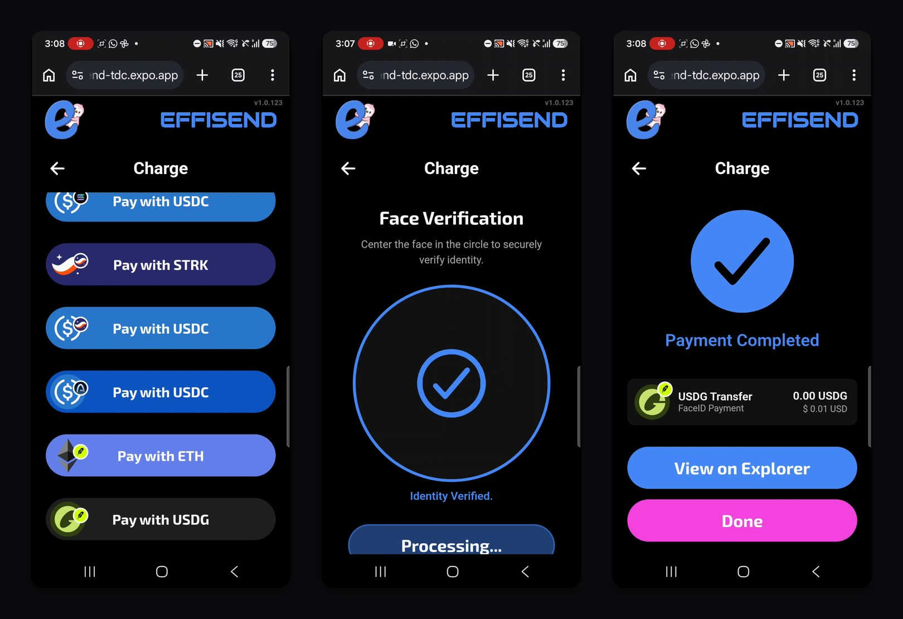

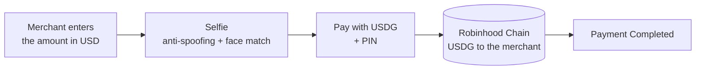

**Proof:** [`0x06c2…b604`](https://robin.etherscan.io/tx/0x06c2a265a34f4df6c743208f2829e58ffa89b69a96d53de529689ee4fba8b604), 0.009999 USDG to the point of sale (2026-10-02).

---

## 2. Robinhood Pay

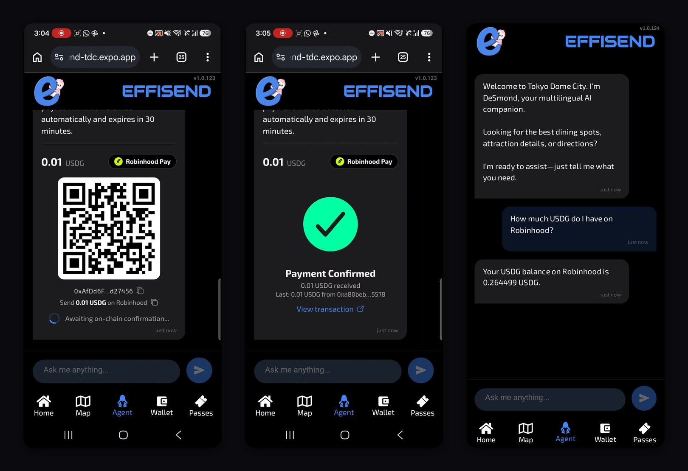

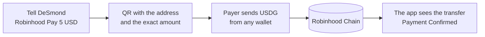

**Proof:** [`0x9461…607a`](https://robin.etherscan.io/tx/0x94611b2590778ac952ef9b365e2aa0c82d4532b51d14ce55776b71e56dea607a), 0.01 USDG detected and confirmed by the card (2026-10-02).

---

## 3. Robinhood Order

<p align="center">
  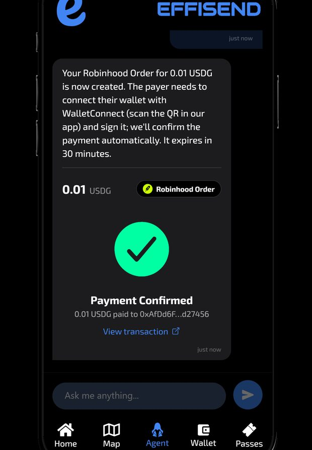
</p>

Same counter, now enforced by a contract: the QR opens by itself, the payer signs once and pays no gas.

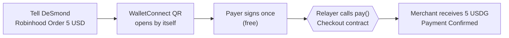

**Proof:** [`0x0e94…7ba1`](https://robin.etherscan.io/tx/0x0e9461c269c192694de70e099c76b615ffab5448147fa1a86e35bd7a60737ba1), 0.01 USDG from an external wallet to the point of sale (2026-10-23). The payer's ETH balance and nonce were identical before, during and after the block.

---

## 4. Smart contract: Checkout

**One contract settles an order in USDG: exact amount, one payment per order, hard expiry, zero custody.**

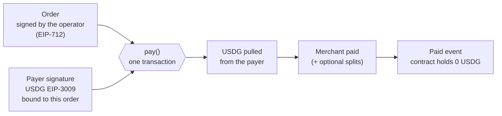

| The chain enforces | How |
|---|---|
| **Exact amount** | The payer's signature commits to the order's amount, merchant and splits. |
| **One payment per order** | `paid(id)` flips once; a replay reverts. |
| **Hard expiry** | 30 minutes, set in the operator-signed order. |
| **No custody** | Every payment ends with 0 USDG in the contract. Any failure reverts everything. |
| **No gas for the payer** | USDG's EIP-3009 authorization plus a relayer. |
| **Revenue splits** | Up to 5 shares, paid in the same transaction. Built and tested, off in the app for now. |

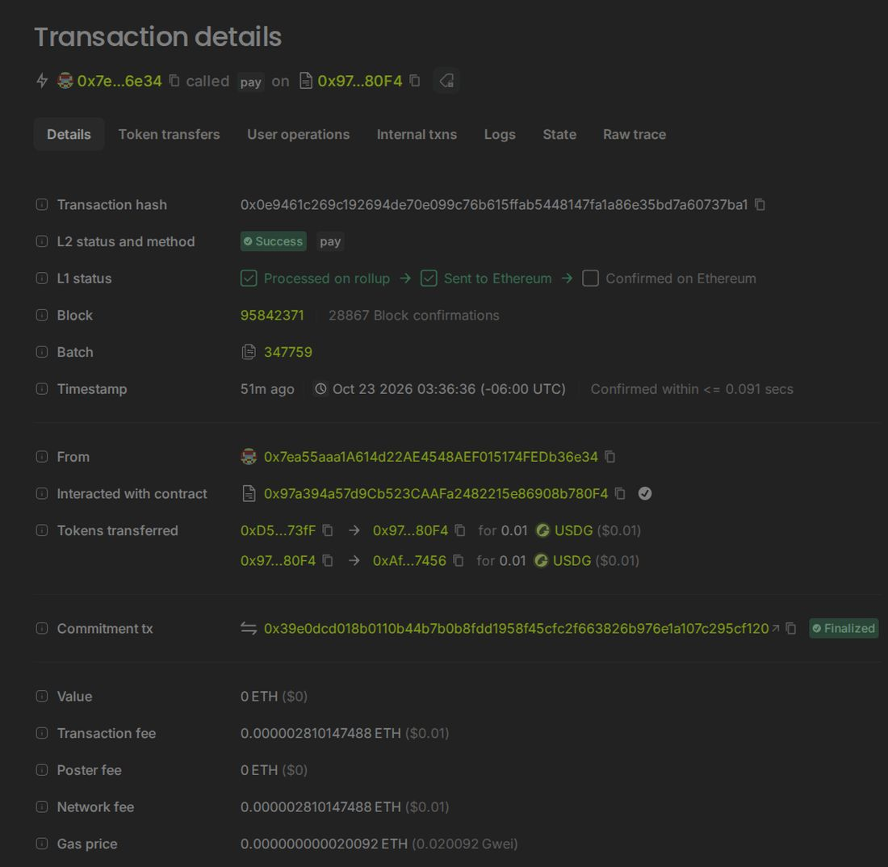

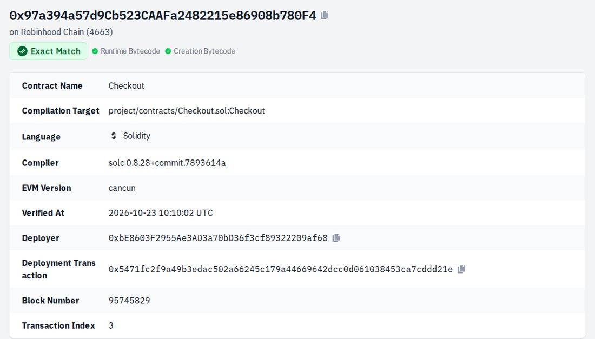

| Proof | Where |
|---|---|
| **Contract** | [`0x97a394a57d9Cb523CAAFa2482215e86908b780F4`](https://robin.etherscan.io/address/0x97a394a57d9Cb523CAAFa2482215e86908b780F4) · deployed in [`0x5471…dd21e`](https://robin.etherscan.io/tx/0x5471fc2f9a49b3edac502a66245c179a44669642dcc0d061038453ca7cddd21e) |
| **Verified** | [Sourcify `exact_match`](https://sourcify.dev/server/v2/contract/4663/0x97a394a57d9Cb523CAAFa2482215e86908b780F4) for runtime and creation bytecode |
| **Source and tests** | [`Contracts/checkout`](Contracts/checkout/README.md): 18 tests, `npm ci && npm test` |

---

## 5. Wallet, swap, bridge and card top-ups

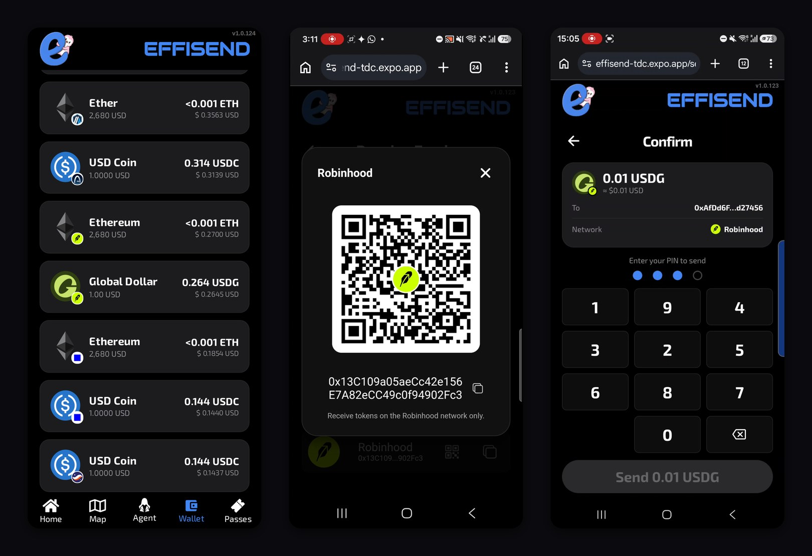

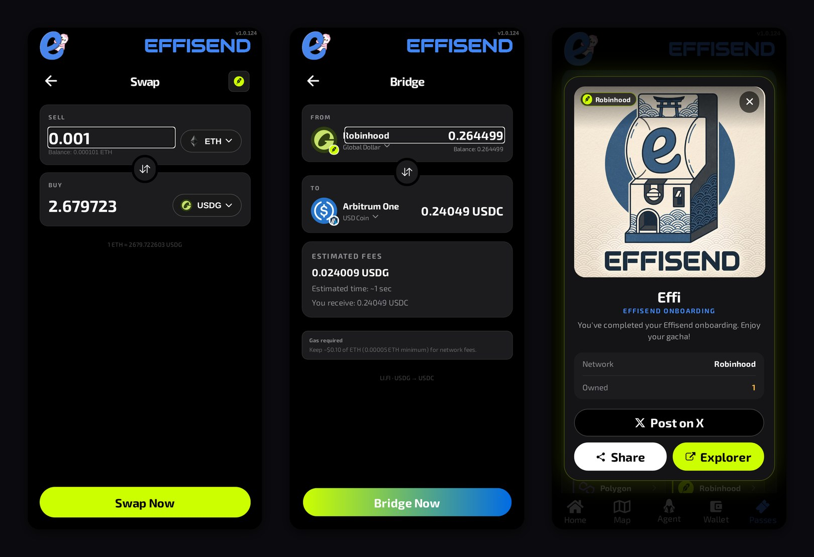

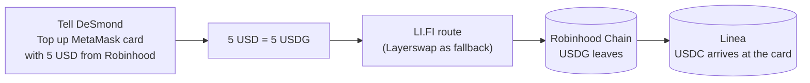

**Proof:** [`0xc9bd…8a75`](https://robin.etherscan.io/tx/0xc9bdb0d58abc5e118317dd58ce53aacd40db4b8e5c362f8b481e78e51baf8a75) on Robinhood, then [`0x3ca8…713e`](https://lineascan.build/tx/0x3ca8e0b83a2fc192741f64669fe91287031cf6b34de408cf91eb209cf234713e) on Linea about a second later (2026-10-01).

---

## 6. Effi NFT

<p align="center">
  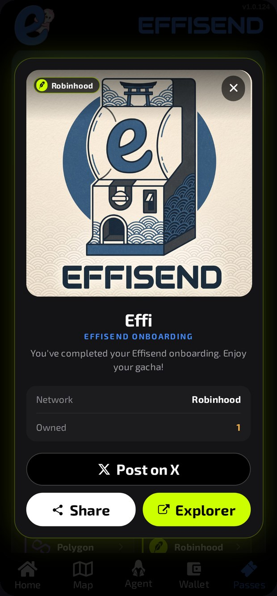
</p>

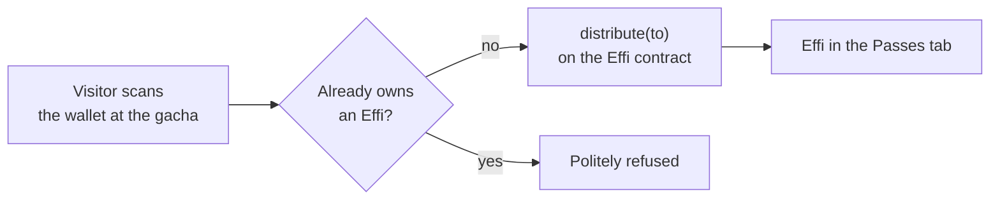

**Proof:** [`0x470f…2d82`](https://robin.etherscan.io/tx/0x470f2546765b6f153ddd4eab91a92479aed53e8b3b2634b507cdb04a3daf2d82), token #0 delivered by `distribute()` (2026-09-30). One address on 7 networks ([`deployments.json`](Contracts/deployments.json)), bytecode matching [`Contracts/`](Contracts/) byte for byte.

---

## Real-world traction: Pudgy Penguins Pop-Up

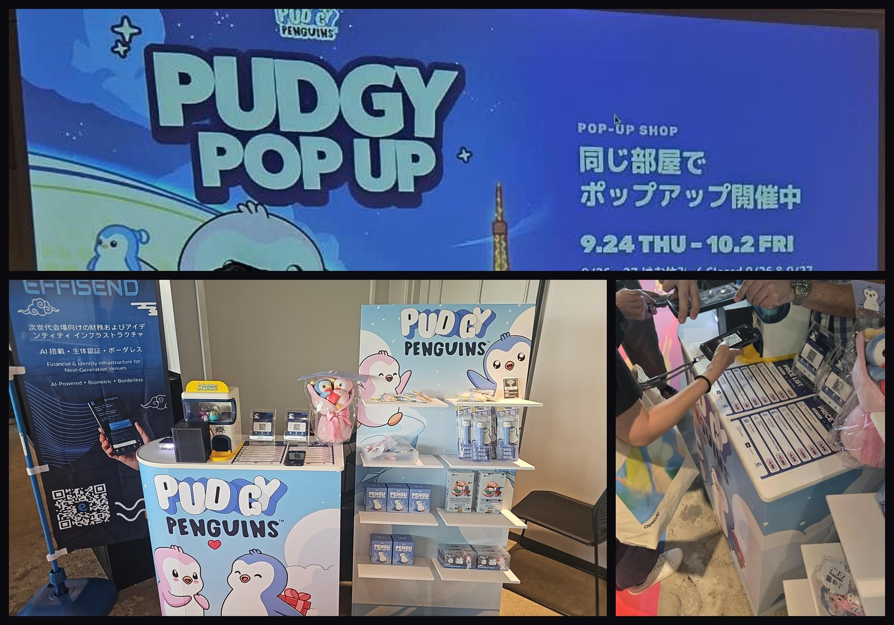

| Metric | Value |
|---|---|
| Paid orders | **20** |
| Gross merchandise value | **$635.67** (18 USDC, 2 USDT) |
| Distinct paying wallets | **14** |
| Average ticket | $31.78 |
| Failed on-chain payments | 0 |

Reconciled from the chains: a payment counts when it reached the point-of-sale wallets in an official token contract, from a wallet that is not Effisend's own.

---

## Architecture

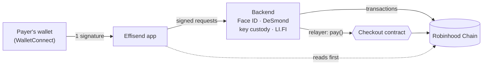

- **Custodial by design:** keys are encrypted with KMS and never reach the device.
- **Face ID with anti-spoofing** before every match, **PIN** for payments, **HMAC-signed API**.
- **Client first, server as fallback:** reads go from the device to public RPCs; the backend steps in only when they fail.
- **DeSmond**, the multilingual AI concierge, runs it all by chat: pay, order, swap, bridge, top-up and balances.

## Repository

```
Contracts/
  contracts/EffisendNFT.sol      Effi NFT, exactly as deployed
  checkout/                      Checkout contract: source, 18 tests, verification input
  deployments.json               Effi addresses on every chain
App/
  robinhood-chain.json           public Robinhood Chain config
  screenshots/                   UI captures and on-chain proof
```

```bash
(cd Contracts && npm ci && EVM=cancun node compile.cjs && node test.cjs)   # Effi NFT
(cd Contracts/checkout && npm ci && npm test)                              # Checkout, 18 tests
```

MIT. See [LICENSE](LICENSE).
